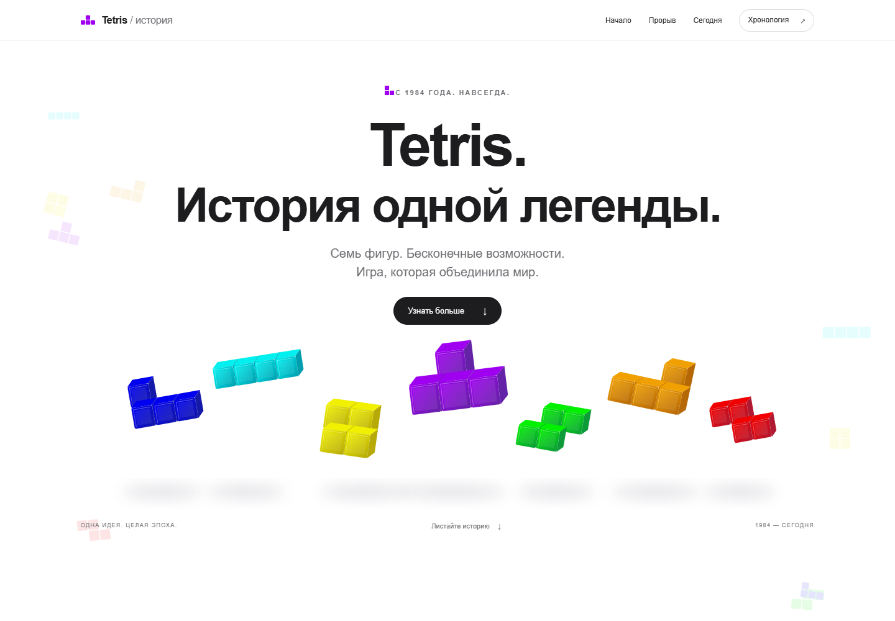
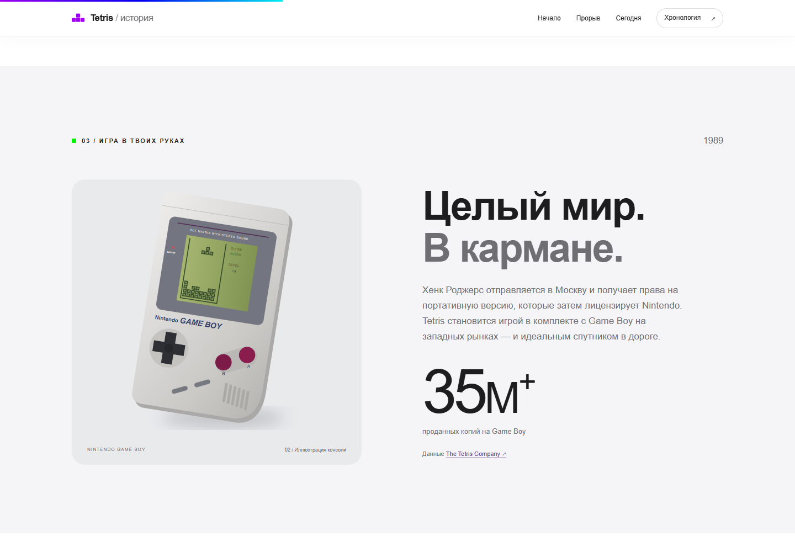
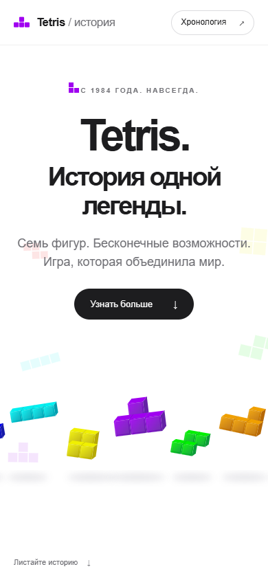

# Tetris. История одной легенды

Одностраничная история Tetris на русском языке: от московской лаборатории до Game Boy, мировых чемпионатов и Tetris Effect. Минималистичная подача, крупная системная типографика, белые и светло-серые секции, оригинальные SVG-иллюстрации и акценты семи тетромино.

Чистые **HTML5, CSS3 и Vanilla JavaScript**. Без сборки, фреймворков, внешних шрифтов, аналитики и сторонних зависимостей.

**Сайт:** [wilberods-coder.github.io/tetris-history](https://wilberods-coder.github.io/tetris-history/).

**Репозиторий:** [wilberods-coder/tetris-history](https://github.com/wilberods-coder/tetris-history). Публикация настроена через GitHub Actions: обновления ветки `main` автоматически отправляются на GitHub Pages. В инструкции ниже `USERNAME` — ваш логин, если вы создаёте собственную копию проекта.

## Скриншоты

Главный экран, 1440 px:



Раздел о Nintendo Game Boy:



Мобильная версия, 390 px:



## Что внутри

- Все десять разделов: главный экран, рождение, экспансия, Game Boy, лицензирование, цифровая эра, киберспорт, современность, хронология и подвал.
- Медленно падающие фигуры на canvas с `requestAnimationFrame`, параллакс, навигация с размытием и прогресс чтения.
- Появление элементов через `IntersectionObserver`: порог `0.15`, длительность `0.8s`, плавная кривая `cubic-bezier(.16,1,.3,1)`.
- Счётчики 35M+ и 500M+, запускающиеся один раз при появлении в окне.
- Семь переключаемых дат. Управление мышью, касанием и клавишами ← / → / Home / End. Ссылка из карточки возвращает к соответствующей главе.
- Адаптивные сетки с точками переключения 768, 1024 и 1440 px.
- Семантическая разметка, ссылка пропуска навигации, видимый фокус, альтернативные описания и ARIA-состояния вкладок.
- Поддержка `prefers-reduced-motion` и кнопка приостановки анимации в подвале. Canvas останавливается вне первого экрана и в скрытой вкладке.
- Основной текст, навигация и источники доступны без JavaScript. Для переключения хронологии нужен JavaScript; все её события также есть в основном тексте.
- Иллюстрации загружаются лениво, кроме главной. Плотность canvas ограничена `devicePixelRatio = 2`.

## Структура

```text
tetris-history/
├── index.html
├── css/
│   └── style.css
├── js/
│   ├── main.js
│   └── tetromino-bg.js
├── assets/
│   ├── favicon.svg
│   ├── tetromino-sculpture.svg
│   ├── electronika.svg
│   ├── gameboy.svg
│   ├── screenshot-desktop.png
│   ├── screenshot-gameboy.png
│   └── screenshot-mobile.png
├── .github/workflows/deploy.yml
├── .gitignore
├── .nojekyll
└── README.md
```

## Локальный запуск

Откройте `index.html` в браузере. Для локального HTTP-предпросмотра, если установлен Python:

```bash
cd tetris-history
python -m http.server 8080
```

Откройте [localhost:8080](http://localhost:8080). Установка пакетов и сборка не нужны.

## Публикация на GitHub Pages

### 1. Создайте репозиторий

Создайте на GitHub пустой публичный репозиторий `tetris-history` без автоматически добавленного README. Выполните команды **в папке, где находится `index.html`**, а не в родительской папке `outputs`:

```bash
git init
git add .
git commit -m "Initial commit: Tetris history site"
git branch -M main
git remote add origin https://github.com/USERNAME/tetris-history.git
git push -u origin main
```

Замените `USERNAME` своим логином. GitHub может попросить авторизоваться. Если используется другой адрес репозитория, укажите его в `git remote add origin`.

### 2. Вариант A — публикация из ветки

1. Откройте репозиторий → **Settings → Pages**.
2. В **Build and deployment → Source** выберите **Deploy from a branch**.
3. В **Branch** выберите **main**, папку **/ (root)**.
4. Нажмите **Save**.
5. Дождитесь завершения публикации. Точный адрес появится в Settings → Pages:
   `https://USERNAME.github.io/tetris-history/`.

Для этого варианта **удалите `.github/workflows/deploy.yml` до первого push**: это альтернативный способ публикации, который здесь не нужен. `.nojekyll` оставьте — сайт уже состоит из готовых статических файлов.

### 3. Вариант B — GitHub Actions

Файл `.github/workflows/deploy.yml` уже включён. Оставьте его в репозитории и выберите в **Settings → Pages → Source** значение **GitHub Actions** вместо публикации из ветки.

Если первый запуск произошёл до настройки Pages и завершился ошибкой, после настройки откройте **Actions → Deploy to GitHub Pages → Run workflow** или повторите неуспешный запуск.

```yaml
name: Deploy to GitHub Pages

on:
  push:
    branches: [main]
  workflow_dispatch:

permissions:
  contents: read
  pages: write
  id-token: write

concurrency:
  group: pages
  cancel-in-progress: true

jobs:
  deploy:
    runs-on: ubuntu-latest
    environment:
      name: github-pages
      url: ${{ steps.deployment.outputs.page_url }}
    steps:
      - uses: actions/checkout@v4
      - uses: actions/configure-pages@v4
      - uses: actions/upload-pages-artifact@v3
        with:
          path: '.'
      - id: deployment
        uses: actions/deploy-pages@v4
```

Используйте один вариант публикации. Все пути к CSS, JavaScript и изображениям относительные, поэтому сайт работает в подпапке `/tetris-history/`.

### 4. Обновление

После изменений:

```bash
git add .
git commit -m "Update Tetris history"
git push
```

GitHub Pages опубликует обновлённую версию автоматически. Замените шаблон ссылки на живой сайт в начале README фактическим адресом из Settings → Pages.

## Историческая точность

Источники проверены 12 октября 2026 года. Ссылки приведены рядом с соответствующими фактами и в раскрываемом списке в подвале сайта.

- Официальная дата рождения — 6 июня 1984 года. Первая версия — Алексей Пажитнов и «Электроника-60». Вадим Герасимов работал над версией для IBM PC; Дмитрий Павловский участвовал в ранней команде и совместных игровых проектах. Их роли описаны раздельно.
- Предприниматель, получивший права для портативных систем, — **Хенк Роджерс (Henk Rogers)**. Имя «Генрих Ленджанов» из исходного задания не подтверждается.
- Главный спор Tengen/Nintendo о консольных правах относится к **1989 году**. Поэтому глава о юридических войнах охватывает 1989–1990-е.
- **35M+** — проданные копии на Game Boy. **500M+** — консервативный порог продаж франшизы: правообладатель сообщает о более чем 520 млн копий. Эти значения не описывают уникальных игроков. Неподтверждённое утверждение о миллиардах игроков не включено.
- Цитата Роджерса — короткий перевод фрагмента интервью Time с прямой ссылкой.
- Изображения терминала, Game Boy и композиция Tetris Effect — авторские иллюстрации, не фотографии или скриншоты исторических игр.

Основные источники: [официальная история](https://tetris.com/news/the-history-of-tetris), [Герасимов](https://vadim.oversigma.com/Tetris.htm), [интервью Time](https://time.com/2837390/tetris-at-30-pajitnov-interview/), [биографии The Tetris Company](https://tetris.com/corporate-bios), [архив Atari](https://atariemailarchive.org/thread/lawsuits-with-nintendo-810), [CTWC](https://thectwc.com/champions/jonas-neubauer/), [Guinness World Records](https://www.guinnessworldrecords.com/world-records/764734-first-player-to-reach-the-killscreen-in-tetris-nes), [Tetris Effect](https://www.tetriseffect.game/), [статистика 2026 года](https://play.tetris.com/news/the-tetris-company-celebrates-world-tetris-day).

## Проверка

Проверено в локальном Chrome на ширинах **360, 390, 768, 1024 и 1440 px**: горизонтального переполнения нет. Проверены загрузка файлов без HTTP-ошибок, отсутствие ошибок JavaScript, все семь дат, управление хронологией с клавиатуры, ссылки на главы, счётчики, прогресс чтения, отключение анимации, системная настройка уменьшения движения и доступность основного текста без JavaScript. Скриншоты получены из браузера.

Состояние публикации можно посмотреть на вкладке [Actions](https://github.com/wilberods-coder/tetris-history/actions).

## Права и обозначения

Независимый образовательный проект. Tetris — товарный знак Tetris Holding; Nintendo и Game Boy принадлежат соответствующему правообладателю. Сайт не связан с Apple, Nintendo или The Tetris Company. Официальные логотипы и архивные фотографии не используются. Минималистичный дизайн вдохновлён подходом Apple, но не является копией сайта apple.com.
